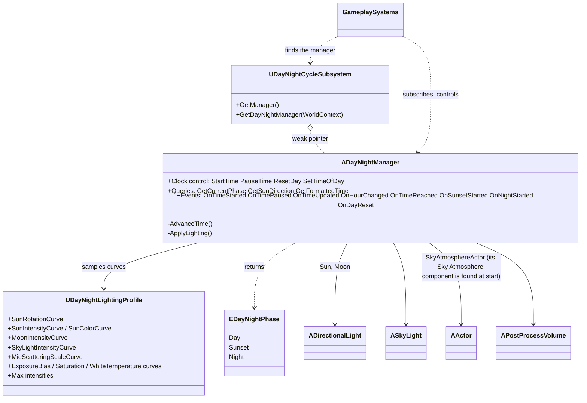
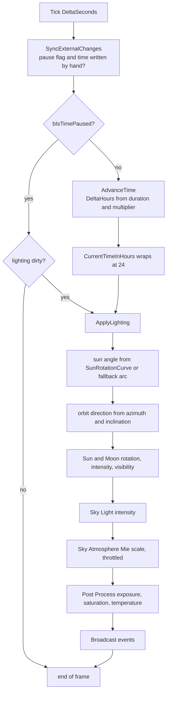
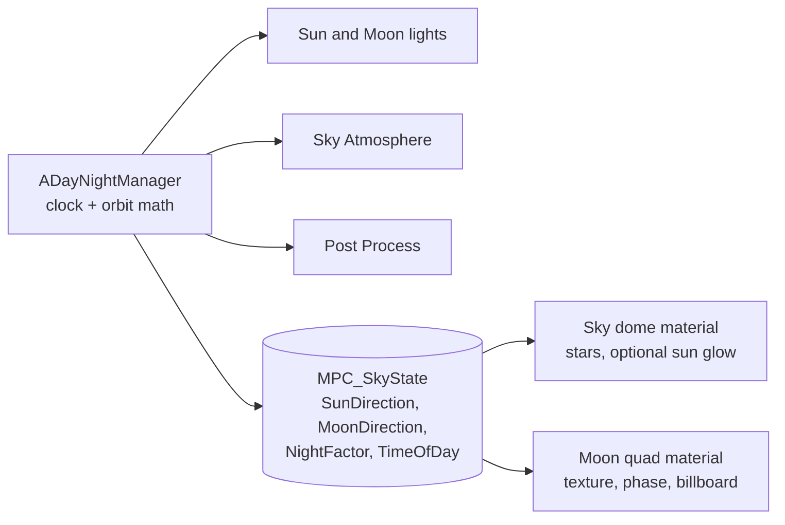

# Architecture & API — Day/Night Cycle

**Project:** Sunset Cove  |  **Engine:** Unreal Engine 5.8  |  **Module:** `SunsetCove`
**Source of truth:** GDD, *Feature Sheet — Day/Night Cycle*.
**Audience:** programmers who build on the system. Designers: see `Engine_Setup_Guide_DayNightCycle.md`.
**Revision 2.**

> **What changed in this revision**
> - A curve that is assigned but has **no keys** is now ignored (and reported). It used to be sampled as 0, which turned the world gray (4.5).
> - Auto exposure support: new profile fields `ExposureMode`, `DayExposureEV100`, `ExposureMinOffsetCurve`, `ExposureMaxOffsetCurve` (4.5, 5.4).
> - New editor buttons and validation: `RefreshLighting`, `ResetPostProcessOverrides`, extra checks at setup time (4.6, 5.1).
> - `SkyAtmosphereActor` is an `AActor*` (the team's compile fix); `MoonMaxIntensity` default lowered to 0.05 (5.4, 7).
> - New section 10: how to give the sun and the moon their own visuals (assets, Material Parameter Collection).

---

## 1. Purpose and boundaries

The Day/Night Cycle is a **closed, environment-only system**.

| It does | It does NOT do |
|---|---|
| keep the game clock | open or close the barrier |
| rotate and dim the Sun and the Moon | spawn or remove NPCs |
| drive Sky Light, Sky Atmosphere, Post Process | decide opening hours, closing rules, warnings |
| announce clock events through delegates | touch money, reputation or any economy rule |
| answer read-only questions (time, phase, sun direction) | know that other systems exist |

The dependency is **one-way**: gameplay → `ADayNightManager`. The manager never includes, calls or references a gameplay class.
A gameplay system (the GDD's `BP_WorkdayManager`) subscribes to the events, and calls the control functions when it needs to.

---

## 2. Files and folder layout

The project splits the module as `Public/<Area>/` and `Private/<Area>/`, and the system follows that.
Includes are written from the `Public` root: `#include "Environment/DayNightCycle/DayNightManager.h"`.

```
Source/SunsetCove/
├── Public/Environment/DayNightCycle/
│   ├── DayNightManager.h               ADayNightManager        the clock + the lighting driver
│   ├── DayNightCycleSubsystem.h        UDayNightCycleSubsystem lookup of the active manager
│   └── Data/
│       ├── DayNightTypes.h             EDayNightPhase
│       └── DayNightLightingProfile.h   UDayNightLightingProfile data asset (the curves)
└── Private/Environment/DayNightCycle/
    ├── DayNightManager.cpp
    └── DayNightCycleSubsystem.cpp
```

`Content/Environment/DayNightCycle/` holds the assets (BP, data asset, curves). Add `Components/` or `Interfaces/` subfolders under
`Public`/`Private` only when the system grows past what fits comfortably in the files above.

---

## 3. Architecture overview

### 3.1 Classes



*Gameplay systems* is any listener (workday manager, HUD, NPC brain). The arrows go from them to the manager, never back.

### 3.2 How time drives light (one frame)



The same data flow as text:

```
Real time (DeltaSeconds)
   └─ x (MainSpanEndHour - StartHour) / (RealWorldDayDurationMinutes x 60) x TimeSpeedMultiplier
        └─ CurrentTimeInHours  (0..24, wraps)
             ├─ SunRotationCurve(hour)  → orbit angle → direction → Sun rotation
             │                                        └─ +MoonOrbitOffset → Moon rotation
             ├─ SunIntensityCurve(hour)  x SunMaxIntensity      → Sun intensity (+ hide when 0)
             ├─ MoonIntensityCurve(hour) x MoonMaxIntensity     → Moon intensity (+ hide when 0)
             ├─ SkyLightIntensityCurve(hour) x SkyLightMax      → Sky Light intensity
             ├─ MieScatteringScaleCurve(hour)                   → Sky Atmosphere
             └─ Exposure / Saturation / Temperature curves(hour) → Post Process Volume
```

---

## 4. How it works inside

### 4.1 The clock

- `CurrentTimeInHours` is a float in `[0, 24)`: `13.5` is 13:30.
- **Speed.** `RealWorldDayDurationMinutes` real minutes cover `StartHour → MainSpanEndHour` (default 12 min for 07:00 → 19:00, which is 1 game hour per real minute). `TimeSpeedMultiplier` scales it for testing.
- **Continuous flow.** Nothing stops the clock at 19:00: sunset, evening and night follow, as the GDD requires. Reaching 24:00 wraps to 00:00 (proposal: the GDD is silent) and the clock keeps running. Only `ResetDay()` freezes it again at `StartHour`.
- **Delta cap.** One step is capped below 24 hours so a long hitch cannot make the crossing tests ambiguous.
- **Pause is a state, not a stop of the tick.** The actor ticks even when paused; that tick is the cheap path that notices values written by hand (4.2) and applies pending lighting changes.

### 4.2 Running vs jumping

| | Clock **runs** (`AdvanceTime`) | Clock **jumps** (`SetTimeOfDay`, `ResetDay`, direct write) |
|---|---|---|
| `OnTimeUpdated` | every frame | once |
| `OnHourChanged` | once per whole hour crossed | once, only if the hour is different |
| `OnTimeReached`, `OnSunsetStarted`, `OnNightStarted` | when the clock **runs through** the hour | **never**: a jump is not "the clock reached that hour" |

**Direct writes are safe.** `CurrentTimeInHours` and `bIsTimePaused` are `BlueprintReadWrite` (as the brief asks), and they can also be edited in the Details panel during Play In Editor. The manager remembers the last value it wrote or announced, and at the start of each tick compares:
a different time becomes a jump; a different pause flag fires `OnTimeStarted` / `OnTimePaused`. Prefer the functions in your own code, but nothing breaks if a Blueprint writes the variable.

### 4.3 Crossing detection

An hour `H` is crossed in a step from `Prev` to `End = Prev + Delta` (`End` not wrapped) when:

```
(H > Prev && H <= End)   ||   (H + 24 > Prev && H + 24 <= End)
```

- start excluded, end included: a target hit exactly fires once, and is not fired again next frame;
- the second clause handles midnight, and targets given as `24` are normalised to `0`;
- the same test serves whole hours, `SunsetStartHour`, `NightStartHour` and registered time targets.

If a step crosses several registered targets (after a hitch) they fire **in the order the clock reached them**.
Targets are collected before any event fires, so a listener may register or unregister targets inside its handler.

### 4.4 Sun and moon geometry

The sun moves on a circle. `SunRotationCurve(hour)` gives the position on it in degrees: 0 rising, 90 highest, 180 setting, 270 lowest.

```
East = Vector(yaw = SunPathAzimuthDegrees)                  horizontal, where the sun rises
Side = Vector(yaw = SunPathAzimuthDegrees + 90)             horizontal, perpendicular
Top  = Up * cos(incl) + Side * sin(incl)                    "up" of the circle, tilted by SunPathInclinationDegrees
Sun direction (toward the sun) = East * cos(angle) + Top * sin(angle)     // unit length
Light rotation = (-direction).Rotation()                    // a directional light shines along its forward axis
```

- East and Top are unit and perpendicular, so the result is a unit vector and **the horizon crossings stay at 0° and 180° whatever the tilt**. Noon height is `90 − inclination`.
- The **moon** uses the same circle at `angle + MoonOrbitOffsetDegrees` (default 180: always opposite the sun).
- **No `SunRotationCurve`?** A fallback arc is used so the system works out of the box: straight lines from `FallbackSunriseHour` (0°) to `FallbackSunsetHour` (180°), then on to 360° across the night.
- The direction is cached: `GetSunDirection()` and `GetSunElevationDegrees()` cost nothing.

### 4.5 Lighting rules

1. **An empty slot, or a curve with no keys, means "not driven".** The manager leaves that value as set on the light or volume. This is what lets the system work before art has authored anything. A curve asset with no keys reads **0 at every hour**, so an *assigned but empty* curve is treated exactly like an unassigned one (`HasKeys` / `UsableCurve` in `DayNightManager.cpp`) and reported by `ValidateSetup`. Without this guard, an empty Saturation curve wrote saturation 0 (a gray world), an empty Sun Intensity curve switched the sun off, and an empty Rotation curve froze the sun on the horizon.
2. **Intensity curves are multipliers**, multiplied by the `Max` value in the profile. One field rescales a whole day.
3. **Light visibility.** A Sun/Moon light whose multiplier is ≤ 0.001 is hidden (`SetVisibility(false)`), so an inactive light pays no shadow cost. Visibility is only touched when it *changes*, because it rebuilds the light's render state.
4. **Sky Atmosphere.** The sky color comes from the lights flagged *Atmosphere Sun Light* in the level (Sun index 0, Moon index 1). The manager only drives the Mie scale, and only when it moved by more than 1 % (updating it rebuilds atmosphere data).
5. **Post Process.** Writes on the volume's `Settings`, setting the matching `bOverride_*` flag, **only for the curves that are usable (rule 1)**. The volume must be Infinite Extent (checked at setup).
   - **Exposure method:** `Histogram` or `Basic` if `ExposureMode` asks for it, otherwise untouched.
   - **Exposure range (EV100):** `AutoExposureMinBrightness = DayExposureEV100 + MinOffset(hour)` and likewise for Max. The two curves are **offsets from one calibration value**, so recalibrating changes one number. If Max falls below Min it is raised to Min (adaptation is off when Min = Max). A lower EV100 is a brighter picture, so *Min limits how far a dark scene may brighten*: it is the main control of how dark the night stays. The values are EV100 only because the project enables *Extend default luminance range*; the manager checks that console variable at setup.
   - **Exposure compensation:** `AutoExposureBias`, on top of the range. It replaces the volume's and the project's own compensation.
   - **Saturation:** `ColorSaturation = (s, s, s, 1)`, never below 0.
   - **White balance:** `WhiteTemp`, clamped to 1500–15000 K.
6. **Lighting is applied before events.** A listener that reads the sky inside a handler sees the final look of that frame.

### 4.6 Editor behaviour

- `OnConstruction` and `PostEditChangeProperty` apply the lighting in an **editor world**, so the viewport follows the Details panel: drag `CurrentTimeInHours` to scrub the day.
- `bSnapToStartHourOnBeginPlay` (default on) resets the clock to `StartHour` at BeginPlay, so a preview time saved in the level never leaks into the game.
- `ValidateSetup()` runs at BeginPlay, **and in the editor whenever the profile or a reference is assigned**. It writes to `LogSunsetCove`: missing sun, no profile, non-Movable lights, Sun = Moon, a Sky Atmosphere actor with no atmosphere component, a post process volume that is not Unbound, impossible hour order, **every assigned curve that has no keys**, and exposure-range curves used while the project's extended luminance range is off.
- **Editor writes persist.** In an editor world the manager writes into the light actors and the post process volume placed in the level, and the level saves what is there. That is why the preview works, and also why a bad value (the gray bug) stays in the volume after its cause is fixed. `ResetPostProcessOverrides()` (editor button) switches off every override the manager writes, and marks the volume modified so the clean state is saved. In Play In Editor the actors are copies, so nothing persists.
- **Curve assets do not notify the manager when edited.** Press `RefreshLighting` (editor button) after editing a curve.

### 4.7 Finding the manager

`UDayNightCycleSubsystem` (a `UWorldSubsystem`) holds one weak pointer. The manager registers in **`PostInitializeComponents`**, which runs for every actor before any actor's `BeginPlay`, so the lookup already works in everyone's `BeginPlay`. A second manager in the same world is reported and ignored by the lookup. Only game worlds register (never the editor world).

---

## 5. API reference

All names are in the **`DayNightCycle`** category (with a subcategory after `|`).

### 5.1 Control functions — `BlueprintCallable`

| Function | Does | Events fired |
|---|---|---|
| `StartTime()` | lets the clock run | `OnTimeStarted` (if it was paused) |
| `PauseTime()` | freezes the clock; light stays put | `OnTimePaused` (if it was running) |
| `SetTimePaused(bool bPause)` | one call for both | as above |
| `ResetDay()` | clock → `StartHour`, paused, lighting updated | `OnTimePaused` (if it was running), `OnTimeUpdated`, `OnHourChanged` (if hour changed), `OnDayReset` |
| `SetTimeOfDay(float Hour)` | jump to `Hour` (0–24), paused state unchanged. Use for night events such as waking the player at 02:00 | `OnTimeUpdated`, `OnHourChanged` (if hour changed) |
| `RegisterTimeTarget(float Hour)` | adds an hour for `OnTimeReached`; duplicates ignored | — |
| `UnregisterTimeTarget(float Hour)` | removes it | — |
| `ClearTimeTargets()` | removes all, including Details-panel ones | — |
| `SetLightingProfile(UDayNightLightingProfile*)` | swaps the profile, refreshes lighting | — |
| `RefreshLighting()` | reapplies lighting for the current time. **`CallInEditor`: a button in the Details panel** | — |
| `ResetPostProcessOverrides()` | switches off the post process overrides the manager writes on the referenced volume (exposure method, range, compensation, saturation, white balance). **`CallInEditor` button.** Does not touch the lights | — |

### 5.2 Queries — `BlueprintPure`

| Function | Returns |
|---|---|
| `GetCurrentHour()` | `int32` 0–23 |
| `GetCurrentMinute()` | `int32` 0–59 |
| `GetFormattedTime()` | `FText` `"HH:MM"` |
| `GetCurrentPhase()` / `GetPhaseAtHour(float)` | `EDayNightPhase`: `Day` `[StartHour, SunsetStartHour)`, `Sunset` `[SunsetStartHour, NightStartHour)`, `Night` otherwise |
| `GetSunDirection()` | unit `FVector` **from the world toward the sun** (opposite of the light's forward). For shade and similar logic |
| `GetSunElevationDegrees()` | `float`: 90 overhead, 0 on the horizon, negative at night |

### 5.3 Event dispatchers — `BlueprintAssignable`

| Delegate | Signature | Fires when | GDD |
|---|---|---|---|
| `OnTimeStarted` | `()` | the clock goes from paused to running | ✔ |
| `OnTimePaused` | `()` | the clock goes from running to paused | ✔ |
| `OnTimeUpdated` | `(float CurrentTimeInHours)` | every frame the clock runs, and once per jump. For smooth HUDs | brief |
| `OnHourChanged` | `(float CurrentHour)` | a whole hour is crossed. `CurrentHour` is a whole number 0–23. Several in a row after a hitch | ✔ |
| `OnTimeReached` | `(float TargetHour)` | the clock **runs through** a registered hour. `TargetHour` is normalised to `[0, 24)` | ✔ |
| `OnSunsetStarted` | `()` | the clock runs through `SunsetStartHour` | brief |
| `OnNightStarted` | `()` | the clock runs through `NightStartHour` | brief |
| `OnDayReset` | `()` | at the end of `ResetDay()` | ✔ |

**Order inside one running frame:** `OnTimeUpdated` → `OnHourChanged` (each hour) → `OnSunsetStarted` / `OnNightStarted` → `OnTimeReached`.

**Re-entrancy.** A handler may call any control function (pause, reset, set time). The remaining events *of that frame* still fire: they describe what the clock did in that step.

### 5.4 Properties

**Time**

| Property | Type | Default | Access | Notes |
|---|---|---|---|---|
| `RealWorldDayDurationMinutes` | float | 12 | EditAnywhere, RW | min 0.1. Real minutes for `StartHour → MainSpanEndHour` |
| `StartHour` | float | 7 | EditAnywhere, RW | 0–24 |
| `MainSpanEndHour` | float | 19 | EditAnywhere, RW | 0–24. Clock speed reference only |
| `TimeSpeedMultiplier` | float | 1 | EditAnywhere, RW | ≥ 0 |
| `CurrentTimeInHours` | float | 7 | EditAnywhere, RW | 0–24. Direct writes are treated as jumps |
| `bIsTimePaused` | bool | true | EditAnywhere, RW | direct writes fire `OnTimeStarted`/`OnTimePaused` |
| `bSnapToStartHourOnBeginPlay` | bool | true | EditAnywhere, RW | |

**Phases / events**

| Property | Type | Default | Access | Notes |
|---|---|---|---|---|
| `SunsetStartHour` | float | 19 | EditAnywhere, RW | GDD: sunset begins at 19:00 |
| `NightStartHour` | float | 21 | EditAnywhere, RW | **Proposal**, not in the GDD |
| `TimeReachedTargets` | `TArray<float>` | empty | EditAnywhere, RO | use `RegisterTimeTarget` from code |

**Sun path**

| Property | Type | Default | Notes |
|---|---|---|---|
| `SunPathAzimuthDegrees` | float | 0 | world yaw the sun rises from |
| `SunPathInclinationDegrees` | float | 20 | −60…60. Noon height = 90 − value |
| `MoonOrbitOffsetDegrees` | float | 180 | |
| `FallbackSunriseHour` / `FallbackSunsetHour` | float | 6.5 / 20 | only without `SunRotationCurve` |

**References and look**

| Property | Type | Access | Notes |
|---|---|---|---|
| `SunDirectionalLight` | `ADirectionalLight*` | EditInstanceOnly, RW | required. Movable, Atmosphere Sun Light index 0 |
| `MoonDirectionalLight` | `ADirectionalLight*` | EditInstanceOnly, RW | optional. Index 1 |
| `SkyLightActor` | `ASkyLight*` | EditInstanceOnly, RW | optional. Movable, Real Time Capture |
| `SkyAtmosphereActor` | `AActor*` | EditInstanceOnly, RW | optional. A generic actor on purpose (compile fix); the Sky Atmosphere component is found on it, with a warning if absent |
| `PostProcessVolume` | `APostProcessVolume*` | EditInstanceOnly, RW | optional. Unbound |
| `LightingProfile` | `UDayNightLightingProfile*` | EditAnywhere, RW | the curves |

**`UDayNightLightingProfile`** (data asset). X axis of every curve = hour 0–24. A slot left empty, or a curve with no keys, means "not driven".

| Property | Type | Default | Notes |
|---|---|---|---|
| `SunRotationCurve` | `UCurveFloat` | — | sun position on its arc in degrees (0 rising, 90 top, 180 setting, 270 lowest); hour 24 = hour 0 + 360 |
| `SunIntensityCurve` / `SunMaxIntensity` | curve / float | — / 10 | multiplier 0–1 × max, in lux |
| `SunColorCurve` | `UCurveLinearColor` | — | optional extra tint |
| `MoonIntensityCurve` / `MoonMaxIntensity` | curve / float | — / **0.05** | was 0.5 in revision 1 (too bright) |
| `SkyLightIntensityCurve` / `SkyLightMaxIntensity` | curve / float | — / 1 | |
| `MieScatteringScaleCurve` | `UCurveFloat` | — | **absolute** Mie scale (atmosphere default about 0.004) |
| `ExposureMode` | `EDayNightExposureMode` | `LeaveAsIs` | `LeaveAsIs`, `Histogram`, `Basic` |
| `DayExposureEV100` | float | 1 | calibration: EV100 at which a sunny noon looks right |
| `ExposureMinOffsetCurve` / `ExposureMaxOffsetCurve` | `UCurveFloat` | — | offsets in stops from `DayExposureEV100` |
| `ExposureBiasCurve` | `UCurveFloat` | — | exposure compensation in EV |
| `SaturationCurve` | `UCurveFloat` | — | 1 = unchanged |
| `WhiteTemperatureCurve` | `UCurveFloat` | — | Kelvin, 6500 neutral |

### 5.5 Subsystem

| Member | Notes |
|---|---|
| `UDayNightCycleSubsystem::GetDayNightManager(const UObject* WorldContext)` | static, `BlueprintPure` ("Get Day Night Manager"). Returns null if the level has no manager |
| `GetManager()` | same, called on the subsystem |

---

## 6. Integration examples

> The workday system below **does not exist yet**; it is an illustration of how it plugs in. Names are placeholders.

**C++ listener (for example a future workday manager)**

```cpp
void AWorkdayManager::BeginPlay()
{
	Super::BeginPlay();

	if (ADayNightManager* Clock = UDayNightCycleSubsystem::GetDayNightManager(this))
	{
		Clock->RegisterTimeTarget(18.f); // closing warning
		Clock->RegisterTimeTarget(19.f); // stop new arrivals
		Clock->OnTimeReached.AddDynamic(this, &AWorkdayManager::HandleTimeReached);
		Clock->OnDayReset.AddDynamic(this, &AWorkdayManager::HandleDayReset);
	}
}

void AWorkdayManager::HandleTimeReached(float TargetHour) { /* 18 -> warn, 19 -> stop arrivals */ }

void AWorkdayManager::OnPlayerPressedStartButton()   // the button near the barrier
{
	if (ADayNightManager* Clock = UDayNightCycleSubsystem::GetDayNightManager(this))
	{
		Clock->StartTime();
	}
}
```

Handlers bound with `AddDynamic` must be `UFUNCTION()`s. Unbind in `EndPlay` if the listener can die before the manager.

**Resting in the cave** (the player interacts with the bed): call `ResetDay()`. The clock returns to 07:00, paused, and `OnDayReset` tells the other systems to start their morning routine.

**Waking the player at night:** `SetTimeOfDay(2.f)` (clock keeps its paused/running state).

**HUD clock:** bind `OnTimeUpdated` and show `GetFormattedTime()`; the text only changes once per game minute, so update the widget only when the text changes.

**Shade under an umbrella (if the GDD's open question becomes a feature):** read `GetSunDirection()` / `GetSunElevationDegrees()` in the shade system. The manager exposes the sun and has no idea shade exists.

---

## 7. Design decisions and where they differ from the GDD

| GDD / brief | Implementation | Why |
|---|---|---|
| One `SunLightingCurve` (`UCurveFloat`) for pitch, yaw and intensity | `SunRotationCurve`, `SunIntensityCurve`, … in a `UDayNightLightingProfile` data asset | a single float curve cannot carry rotation and intensity. A data asset also allows presets and `SetLightingProfile` |
| `SkyAtmosphereComponent (USkyAtmosphereComponent*)` | `SkyAtmosphereActor (AActor*)`, component found from the actor | the Details panel cannot pick a component that lives on another actor. It is an `AActor*` because the first version included `Engine/SkyAtmosphere.h`, which is the wrong header: `ASkyAtmosphere` is declared in `Components/SkyAtmosphereComponent.h` (per Epic's API reference for 5.1 and 5.4; 5.8 not confirmed). The team's `AActor*` works and is kept. Reverting to a typed `TObjectPtr<ASkyAtmosphere>` (forward declaration in the header, the include is already in the .cpp) would give a picker filtered to atmosphere actors. Optional |
| Sky Light and Volumetric Clouds listed as driven | Sky Light has a reference. Clouds have none | clouds are lit by the atmosphere lights on their own. Add a reference only when something specific has to be driven |
| `CurrentTimeInHours` "Read-Only / Scriptable" | `EditAnywhere, BlueprintReadWrite` (the brief asks for it) with direct writes detected as jumps | allows editor scrubbing and runtime tests without breaking event consistency |
| `OnHourChanged(float CurrentHour)` | fires on whole hours. `OnTimeUpdated` is the per-frame one | the brief lists both; the HUD clock uses `OnTimeUpdated` |
| `OnTimeReached(float TargetHour)` "registrable" | `RegisterTimeTarget` / `UnregisterTimeTarget` + the `TimeReachedTargets` array, empty by default | which hours matter is a gameplay decision |
| `OnSunSetStarted` (brief) | named `OnSunsetStarted` | spelling of the word |
| Exposure bias for the post process volume (GDD: "regolare esposizione") | `ExposureBiasCurve` plus, new, an EV100 range (`ExposureMin/MaxOffsetCurve` around `DayExposureEV100`) | with auto exposure on, the bias alone cannot keep the night dark; the range does |
| Pre-day 07:00 paused; running; continues after 19:00; reset | as specified | — |
| Night events at e.g. 02:00 | `SetTimeOfDay(2.f)` | — |
| Folder `Source/SunsetCove/Environment/DayNightCycle/{Public,Private}` (brief) | `Public/Environment/DayNightCycle/` and `Private/Environment/DayNightCycle/` | the repo's existing layout; nested `Public` folders are not on the include path |
| Category `DayNightCycle` | `DayNightCycle` with subcategories (`DayNightCycle\|Time`, …) | keeps the Details panel readable. The repo's own style is `SunsetCove\|…`; the GDD wins here |

**Proposals not defined by the GDD** (change freely): wrap at 24:00 and keep running · `NightStartHour = 21` · the moon sits opposite the sun · default max intensities (10 / 0.05 / 1) · the Mie scale as the only atmosphere parameter driven.

---

## 8. Performance

- **Per frame while running:** two light rotations and intensities, one sky light intensity, a few post-process fields, a handful of curve samples, and the `OnTimeUpdated` broadcast. Cheap.
- **Paused:** a few comparisons.
- **Sun/Moon hidden at 0:** removes that light's shadow cost when it adds no light.
- **Atmosphere:** updated only on a >1 % change of the Mie scale.
- **Sky Light Real Time Capture** is an engine cost, not the manager's. Budget it in the level.
- **`OnTimeUpdated`** is a dynamic delegate fired every frame: bind lightweight handlers only (compare the text, not rebuild the widget).

---

## 9. Extending

- **Weather or mood presets:** make another `UDayNightLightingProfile` and call `SetLightingProfile`.
- **Persistent state:** the whole clock is `CurrentTimeInHours` and `bIsTimePaused`. Registered time targets are *not* persistent: the owning system re-registers them on load.
- **Stars, a textured moon, window lights, glow materials:** see section 10. The next step is a Material Parameter Collection written by the manager.
- **Day counter / calendar:** not included. If needed, count `OnDayReset` in a gameplay or game-instance system.
- **More phases:** add values to `EDayNightPhase` and compare against new thresholds in `GetPhaseAtHour`.

---

## 10. Sun and Moon visuals: options and architecture

### 10.1 Why the moon looks like a second sun

Three facts about Unreal's sky explain it:

1. Unreal supports **two atmosphere lights**, meant for "a sun and a moon". The moon is lit and drawn by the same machinery as the sun: it scatters through the atmosphere and **draws a visible disk**.
2. The moon's **disk brightness** is a separate setting on the light: **Atmosphere Sun Disk Color Scale** ("a color multiplied with the sun disk luminance"). At 1 the disk is a full sun-style disk.
3. Moon intensity was 0.5 against a sun of 10: **5 % of the sun**. Because the sky is lit by the moon like by a sun, 5 % is a dim *day*, not a night. And with auto exposure on, a dark night is brightened on top of that.

### 10.2 Feasibility

**Yes, it is feasible**, in three levels of effort. They are cumulative: each level keeps the previous one.

| Level | What | Assets needed | Code | Effort | Result |
|---|---|---|---|---|---|
| **A. Tune what exists** | Moon Max Intensity 0.05, moon **Atmosphere Sun Disk Color Scale** about 0.2, blue light color, night Min EV100 curve | none | none | minutes | a moonlit night without the second-sun look. The moon is still a plain glowing disk |
| **B. Real visuals on the sky** | a textured **moon** (with optional phase), a **star field**, optionally a stylized sun glow, all driven by the manager's state | moon texture, star texture or cubemap, one dome mesh, one quad | small: the manager publishes the sky state to a Material Parameter Collection | a few days, including a prototype | a real moon you can see texture on, stars that fade in at dusk. **Recommended** |
| **C. A full third-party sky pack** | a dynamic-sky product from Fab | the pack | integration | unclear | **Not recommended as it is.** Such packs ship their own clock and their own sun and moon lights: two owners of time and light. Use them as a *source of meshes, textures and materials* only |

### 10.3 Recommended architecture (level B)

**Principle:** `ADayNightManager` stays the **single owner of time and lights**. Sky visuals are **consumers** of its state and never write back. This keeps the one-way dependency of section 1.



**Why a Material Parameter Collection (MPC):** it is the standard way to give *every* material the same few values with no actor-to-actor references. The moon and the stars then need **no Blueprint code**: their materials read the MPC. It also serves window lights, glowing water and anything else that must react to the time of day.

**The parameters** (written by the manager every frame, the same orbit math that rotates the lights, so a visible moon always sits exactly where the moon light comes from):

| Parameter | Type | Meaning |
|---|---|---|
| `SunDirection` | vector | unit vector toward the sun (already computed: `GetSunDirection`) |
| `MoonDirection` | vector | unit vector toward the moon (already computed in `ApplyLighting`) |
| `NightFactor` | scalar 0–1 | 0 by day, 1 deep night, from sun elevation. Fades the stars in and out |
| `TimeOfDay` | scalar | hours. Star rotation = `TimeOfDay x 15` degrees |

**Code needed:** a `TObjectPtr<UMaterialParameterCollection>` property on the manager, plus about 25 lines in `ApplyLighting` using `UKismetMaterialLibrary::SetVectorParameterValue` / `SetScalarParameterValue`. **It is deliberately not in this revision:** parameter names and the night-factor thresholds depend on the assets you choose. Once you choose, it is a small, low-risk change.

**The pieces**

| Piece | What it is | Notes |
|---|---|---|
| Star dome | one big sphere mesh, **Unlit** material tagged **Is Sky**, stars from a cubemap or panoramic texture, rotated by `TimeOfDay`, faded by `NightFactor` | per Epic's reference, Unlit and Opaque materials can be used as sky material on a dome mesh, and **Is Sky meshes get no aerial perspective** |
| Moon | a quad whose material places it at `CameraPosition + MoonDirection x distance` (World Position Offset), faces the camera, shows the moon texture. A phase can be a mask parameter | no actor code: the material reads the MPC |
| Sun | **keep the atmosphere's own sun disk.** Its size is the light's Source Angle, its brightness the Disk Color Scale. Only if the style needs it, add a glow sprite the same way as the moon and set the sun's Disk Color Scale to 0 | a physical disk fits a semi-realistic game |
| Moon light | stays a directional light for lighting, index 1. For a mesh moon set its **Disk Color Scale to 0**, so there is no second disk | keeps the blue sky glow from moonlight |

### 10.4 Things to verify in a prototype (half a day, before committing to assets)

1. **How the dome combines with the atmosphere.** The goal is: the atmosphere draws the sky color, the dome adds only stars and moon. Translucent or additive dome behaviour with the atmosphere has to be tested in 5.8.
2. **Layering against volumetric clouds.** Community reports describe custom moon meshes ending up behind clouds, the wrong order. Test it with your clouds; the fallback is to draw the moon inside the dome material or to fade it under cloud cover.
3. **Sky Light Real Time Capture.** Epic documents that the capture includes **Is Sky dome meshes**. Stars and moon therefore feed the ambient light: keep their emissive values low.
4. **Parallax.** A dome that is large enough and kept centered on the camera shows no star parallax inside the small cove.
5. **Cost.** One dome and one quad: negligible. Textures: a 2K–4K moon and a 4K–8K star map are plenty.

### 10.5 Checklist for a Fab (or any) asset

- **License:** confirm that it allows use in a shipped game, per item.
- **Engine version:** confirmed for 5.8, or an easy upgrade.
- **Does it bring its own clock or its own sun and moon lights?** That is the part that conflicts with this system. A pack whose materials are driven by *parameters* is easy to use; a pack driven by its own Blueprint is not.
- **Material setup:** Unlit, usable as Is Sky, parameters for direction and fade.
- **Texture sizes**, and whether stars come as a cubemap, a panorama or a sphere mesh.
- **A moon** in a form you can use: a texture (square, with alpha or on black) is the simplest.

### 10.6 Recommendation

Do **level A now** (it is only settings; section 9 of the Setup Guide). Collect **two or three candidate assets** (a moon texture, a star map) and run the half-day prototype of 10.4. If it works, I add the MPC publisher to the manager, with the exact parameter names the chosen materials need.

---

## 11. Verification status and open points

**What was checked.** The time-crossing logic (including midnight wrap, exact-hit, huge hitches), the whole-hour event sequence, and the sun-orbit geometry (horizon crossings at 0° and 180° with and without tilt, noon light pitch −90°, unit length) were verified numerically outside the engine. The curve tables in the Setup Guide come from that same arc.

**What was NOT checked.**
- **The C++ has not been compiled** against UE 5.8 (no engine in the authoring environment). Revision 1 was compiled by the team after the `AActor*` fix; **revision 2 has not been compiled**. The new lines most likely to need a touch-up are: the `FPostProcessSettings` fields `AutoExposureMethod`, `AutoExposureMinBrightness`, `AutoExposureMaxBrightness` (and their `bOverride_` flags), the enum values `AEM_Histogram` / `AEM_Basic`, `APostProcessVolume::bUnbound`, `FRichCurve::GetNumKeys` on `UCurveFloat::FloatCurve` and `UCurveLinearColor::FloatCurves`, and `IConsoleManager::FindTConsoleVariableDataInt`. Earlier risks that remain: `SetMieScatteringScale`, and the `FPostProcessSettings` fields `ColorSaturation` and `WhiteTemp`.
- **How a 5.8 build treats the exposure range fields.** Epic documents them as EV100 when the extended luminance range is on (the project has it on). Epic's tracker has an open issue about inconsistent clamp limits on these fields (UE-218856, targeted 5.8), which may show up as the editor refusing some typed values.
- **The numbers in the Setup Guide** (`DayExposureEV100 = 1`, the exposure offsets, the moon values) are art starting points, not measured values.
- **Not checked:** what the gray world looked like in the project. The diagnosis (an assigned curve with no keys) follows from the code and from how empty curves evaluate; the Setup Guide gives the one-look check on the volume.
- The `CoreFramework` plugin (a git submodule) was not available, so nothing here depends on it.

**Open design points (GDD `[DA DEFINIRE]`)**
1. What happens when the clock passes 24:00 and the player has not rested: currently it wraps and keeps running.
2. Final `NightStartHour` and the sun curve (art) so phases match the look.
3. Whether sun position/shade affects visitor satisfaction (`GetSunDirection` is ready; the rule belongs to the visitor/shade system).
4. Whether the clock should continue while the game is in a menu: currently it stops with the game's own pause, since the tick does not run while paused.
