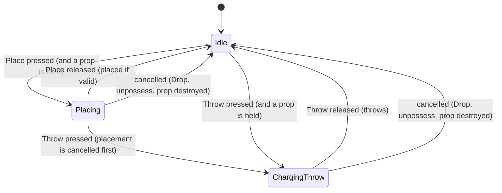

# Architecture Overview — Prop Inventory System

**Project:** Sunset Cove  |  **Engine:** Unreal Engine 5.8  |  **Module:** `SunsetCove`
**Source of truth:** GDD, *Inventario e Strumenti* (Prop Inventory) and *Controlli*.
**Audience:** programmers who build on the system. Designers and anyone setting it up in the editor: see `Engine_Setup_Guide.md`.
**Companion document:** `../InteractionSystem/Interaction_System.md` (the system that triggers the grab).
**Revision 2.**

> **What changed in this revision (2)**
> - New base class `ASunsetCoveProp` (`Public/Gameplay/Props/`): collision-box root + skeletal mesh + grip bone, implementing `IPropInterface`. Props are Blueprint children of it (section 4.5).
> - The hold offset is now computed from the prop's **grip bone** so it lands on the **hand socket**; both come from Blender. `GetPropHoldLocationOffset` / `GetPropHoldRotationOffset` take `bRightHand` (section 4.1, 4.4).
> - The hologram copies skeletal meshes (section 6.2). The inventory validates the hand sockets at `BeginPlay` (section 4.4).

---

## 1. Purpose and boundaries

The Prop Inventory is the **two hands of the player**. It is not a backpack: a prop that is held occupies a hand, physically (it is attached to a socket of the first-person arms). A *prop* is any actor that implements `IPropInterface`. Today that means sunbeds and umbrellas.

| It does | It does NOT do |
|---|---|
| grab a prop into a free hand (called by the Interaction System) | decide *when* a grab is possible (that is the Interaction System aiming, plus its own rules) |
| show a hologram, rotate it, place the prop where it is valid | decide where visitors sit, or price anything |
| charge and throw a prop (power bar value + launch) | draw the power bar (only the value and the events exist; the widget comes later) |
| drop a prop from the hand | play any animation (only the hooks exist) |
| tell the prop and the rest of the game what happened (delegates, interface events) | hold tools (the Tool Inventory is a separate system: `../ToolInventorySystem/Architecture_Overview.md`) |

The dependency direction is **one way**:

```
ASunsetCoveCharacter  ──creates & wires──►  UInteractionComponent
                      ──creates & wires──►  UPropInventoryComponent ──registers a handler──► UInteractionComponent
UPropInventoryComponent ──uses──► IPropInterface (Public/Interfaces/)
IPropInterface / IInteractableInterface / UInteractionComponent   never include anything of the inventory
```

Nothing in `Plugins/CoreFramework` was changed. The framework has no handler for these actions, so the project binds its own Input Actions in `ASunsetCoveCharacter::SetupSunsetCoveInput`, exactly as the framework documents (`Character_Architecture_Overview.md`, section 10).

---

## 2. Files and folder layout

The project splits the module as `Public/<Area>/` and `Private/<Area>/`. Includes are written from the `Public` root.

```
Source/SunsetCove/
├── Public/Interfaces/
│   ├── PropInterface.h                  IPropInterface          "this actor is a prop"
│   └── InteractableInterface.h          IInteractableInterface  "the player can use this with Interact"
├── Public/InventorySystem/PropInventorySystem/
│   ├── PropInventoryTypes.h             EPropHand, EPropInventoryState, EPropAction, EPropHandMeshSource, FPropSlot, delegate signatures
│   ├── PropInventoryComponent.h         UPropInventoryComponent  slots, grab / place / throw / drop, state, delegates, input binding
│   └── PropPlacementHologram.h          APropPlacementHologram   the ghost shown while placing
├── Private/InventorySystem/PropInventorySystem/
│   ├── PropInventoryComponent.cpp
│   └── PropPlacementHologram.cpp
├── Public/Gameplay/Props/SunsetCoveProp.h          ASunsetCoveProp  base class of every prop (Blueprint children)
├── Private/Gameplay/Props/SunsetCoveProp.cpp
├── Public/InteractionSystem/            (separate system, see its own document)
│   ├── InteractionComponent.h
│   └── InteractionTypes.h
├── Private/InteractionSystem/InteractionComponent.cpp
├── Public/Core/Utils/SunsetCoveViewUtils.h      GetOwnerViewPoint(): camera location + rotation of the player
└── (modified) Public/Character/SunsetCoveCharacter.h + Private/Character/SunsetCoveCharacter.cpp
```

`Content/InventorySystem/PropInventorySystem/` is where the editor assets go (Input Actions, hologram material); prop Blueprints go in `Content/Gameplay/Props/`. Nothing in C++ depends on those paths.

---

## 3. Architecture overview

### 3.1 Classes

```mermaid
classDiagram
    class ASunsetCoveCharacter {
        +UInteractionComponent* Interaction
        +UPropInventoryComponent* PropInventory
        +OnPropInventoryAction()
    }
    class UInteractionComponent {
        +InteractAction
        +RegisterInteractionHandler()
        +OnFocusChanged
    }
    class UPropInventoryComponent {
        +Place/Throw/Rotate/Drop actions
        +TryGrabProp()
        +BeginPlacement() ConfirmPlacement()
        +BeginThrowCharge() ReleaseThrow()
        +DropActiveProp()
        +OnStateChanged OnPropAction OnThrowChargeChanged ...
    }
    class APropPlacementHologram {
        +InitializeFromProp()
        +SetValid()
    }
    class IPropInterface {
        <<interface>>
        +IsPickupBlocked()
        +IsPlacementBlocked()
        +GetPropHoldLocationOffset()
        +OnPropGrabbed/Dropped/Placed/Thrown()
    }
    ASunsetCoveCharacter *-- UInteractionComponent
    ASunsetCoveCharacter *-- UPropInventoryComponent
    UPropInventoryComponent ..> UInteractionComponent : registers a grab handler
    UPropInventoryComponent ..> APropPlacementHologram : spawns while placing
    UPropInventoryComponent ..> IPropInterface : asks and notifies
```



### 3.2 Who does what in the character

`ASunsetCoveCharacter` is the composition root and stays thin. It only:

1. creates both components in the constructor;
2. in `PostInitializeComponents`: gives the Prop Inventory its meshes (`SetHandMeshes(FirstPersonMesh, GetMesh())`), registers the grab with the Interaction System (`RegisterWithInteraction`), and listens to `OnPropAction`;
3. in `SetupSunsetCoveInput`: calls `Interaction->SetupInput()` and `PropInventory->SetupInput()`;
4. in `UnPossessed`: calls `PropInventory->CancelCurrentAction()`;
5. in `OnPropInventoryAction`: switches the **rest spots** of the prop (see 9.2).

---

## 4. Props and hands

### 4.1 What makes an actor a prop

It implements `IPropInterface`. In practice, **derive from `ASunsetCoveProp`** (4.5), which implements it and builds the structure of 4.2. Implementing the interface by hand (Blueprint: Class Settings > Interfaces > *Prop Interface*; C++: inherit `IPropInterface`) is still possible for a special prop. Every function of the interface is optional.

The interface functions are phrased as **"blocked" checks** (`IsPickupBlocked`, `IsPlacementBlocked`). A Blueprint that adds an interface but does not implement a function that returns a value gets the default of the type (`false`). With "blocked" semantics the default is the permissive answer, so a prop that implements nothing still works.

| Function | Default | Used for |
|---|---|---|
| `IsPickupBlocked(Picker)` | `false` | refuse the grab (broken, locked, in use) |
| `IsPlacementBlocked(Transform)` | `false` | game rules on top of the inventory's checks, for example "do not block the visitors' path" |
| `GetPropHoldLocationOffset(bRightHand)` | `(0,0,0)` | where the **root** of the prop sits relative to the hand socket (the inventory snaps the root to the socket, then applies this). `ASunsetCoveProp` computes it from the grip bone |
| `GetPropHoldRotationOffset(bRightHand)` | `(0,0,0)` | the rotation that goes with it |
| `OnPropGrabbed / Dropped / Placed / Thrown(Holder)` | nothing | prop-side reactions (sound, particles, physics tweaks) |

### 4.2 What the root component must be

The system attaches the **root component** to a hand and switches physics on it. So the root of a prop must be a **primitive component (static mesh, box...) with Mobility = Movable and simple collision**. If not, the grab is refused and **one warning per prop** is written to `LogSunsetCove`, naming the actor and the problem. A prop whose root is a plain `DefaultSceneRoot` (like the older `BP_Sunbed_Proto` and `BP_Umbrella_Proto`) is refused. `ASunsetCoveProp` always satisfies this (4.5).

For the interaction trace to hit it, the prop must also **block the interaction trace channel** (Visibility by default); the collision preset of `ASunsetCoveProp` does.

### 4.3 Slots and the active prop

Two slots, index 0 = right hand, 1 = left hand (`FPropSlot`: the prop, a grab sequence number, and the collision mode the prop had before it was grabbed).

- **Grab** fills the right hand first, then the left.
- **Place, Throw and Drop act on the active prop: the one grabbed LAST.** `FindActiveSlotIndex` returns the occupied slot with the highest grab sequence. When the active prop leaves the hand, the one grabbed before it becomes active.
- The slot used by a Place or a Throw is **locked when the action starts** (`LockedSlotIndex`), so grabbing or destroying something meanwhile cannot change the target.
- A prop that is destroyed while held is dropped from its slot automatically (`PruneDestroyedProps`), and any action that was working on it is cancelled.

### 4.4 How a prop is held

`TryGrabProp`:

1. checks (`CanGrabProp`): valid actor, implements the interface, state is `Idle`, a hand is free, not already held, `IsPickupBlocked` is false, root is a Movable primitive;
2. saves the collision mode of the root, **switches physics off, then collision off** (order matters: an attached simulating body fights its parent);
3. attaches the actor to the hand socket with `SnapToTargetNotIncludingScale`, then applies the prop's hold offset (`GetPropHoldLocationOffset/RotationOffset(bRightHand)`) as the **relative transform of the root to the socket**;
4. calls `IPropInterface::OnPropGrabbed`, broadcasts `OnPropAction(Grab)` and `OnSlotsChanged`.

**Hand sockets come from Blender.** `Prop_R` and `Prop_L` are made by the animator on the first-person arms and arrive with the FBX (`HandMeshSource = FirstPersonMesh`, the default). A **bone or a socket** both work: attachment and `DoesSocketExist` resolve either by name, so the code does not care which one Blender produced. Nothing is added by hand in the Unreal skeleton. The names are properties (`RightHandSocketName`, `LeftHandSocketName`), so they can follow whatever the animator uses.

**Validation at start.** `BeginPlay` calls `ValidateHandSockets`: if a name is not found on the hand mesh, **one warning** lists the missing names and the mesh, so a wrong name or a missing skeletal mesh asset is found before the first grab.

**Fallback.** If a socket does not exist, the prop is attached to the hand mesh and placed relative to a stand-in socket (`RightHandFallbackLocation` / `LeftHandFallbackLocation` / `HandFallbackRotation`) exactly as it would be relative to the real one, so the system can be tested before the arms exist. If the chosen mesh does not exist, the other mesh is used, then the root of the character.

**How the grip lands on the socket.** The prop's grip (a bone, section 4.5) is fixed relative to its root, call it `G` (grip in root space). Wanted: grip = hand socket (plus the fine-tune offset `F`). The root must then sit at `G⁻¹ · F` relative to the socket. That is what `ASunsetCoveProp` returns from the two offset functions, and why the inventory only needs "root relative to socket".

### 4.5 `ASunsetCoveProp`: the prop base class

`AActor + IPropInterface -> ASunsetCoveProp -> BP_Sunbed, BP_Umbrella...`. To make a prop: a Blueprint child of it, with the **Skeletal Mesh Asset** of `PropMesh` set. Nothing else is required.

| Component | Role |
|---|---|
| `CollisionBody` (root, `UBoxComponent`) | Movable, `PhysicsActor` preset (blocks Visibility and the world), carries the collision, the physics and the attachment to the hand. It is what the interaction trace hits. |
| `PropMesh` (`USkeletalMeshComponent`, child) | The visible, animatable skeleton. **No collision.** Rigid physics on the box moves it as one solid object: a skeleton never ragdolls on a throw. |

- **Auto fit** (`bAutoFitCollisionToMesh`, default on): in `OnConstruction` (so also in the Blueprint viewport) the box is sized from the mesh bounds (`+ CollisionPadding`) and the mesh is moved until its center is on the root. Reason: the root is the center of the box, and the center of the box is the pivot of the physics. The bounds come from the reference pose, brought into root space with the mesh's relative rotation and scale. Off: use `CollisionBoxExtent` and place the mesh by hand.
- **Grip** (`GripSocketName`, default `Grip_R`; optional `LeftGripSocketName`): a bone or socket of the prop skeleton, made by the animator in Blender. `GetGripTransformInRoot` reads it with `GetSocketTransform(..., RTS_Actor)` (the actor space is the root's, location and rotation only). Missing grip: identity (the root center is held) and one warning at `BeginPlay`. The left hand uses `LeftGripSocketName` if it exists, otherwise the same grip.
- **Fine tune** (`HoldLocationOffset`, `HoldRotationOffset`): applied in the space of the hand socket on top of the grip alignment. Zero when the Blender grip is right.
- **Animation**: `PickedUpAnimation` / `PlacedAnimation` (optional `UAnimationAsset`, played once with `PlayAnimation`, so they use single-node mode and replace an Animation Blueprint on the mesh), and the Blueprint events `BP_OnGrabbed / Dropped / Placed / Thrown` (display names *On Grabbed*...) for Animation-Blueprint-driven props.
- **Physics**: `MassKg` (applied in `OnConstruction`), `bStartSimulatingPhysics` (applied in `BeginPlay`, default off: a prop in the level is solid until grabbed). `bCanBePickedUp` backs `IsPickupBlocked`.
- **Caveat for animators**: the grip is read at grab time from the current pose. Keep the grip bone unkeyed (or at rest where it is held), otherwise a prop that was placed with an animated pose will be held at a different offset than one that was never animated.

---

## 5. State machine



| Rule | Detail |
|---|---|
| Only `Idle` accepts a new Place or Throw, and a Grab | `TryGrabProp`, `BeginPlacement` need `Idle` |
| Throw pressed while `Placing` | the placement ends without placing, the charge starts |
| Drop pressed in any state | cancels what is in progress, then drops the active prop |
| Tick | the component ticks **only while not `Idle`** (`SetComponentTickEnabled` in `SetState`) |
| Release without a matching press | ignored (`ConfirmPlacement` / `ReleaseThrow` check the state) |

---

## 6. The four actions

### 6.1 Grab

Not an input of this system. The Interaction System aims from the camera; when the player presses Interact on an actor that no `IInteractableInterface` claims, it asks its registered handlers. The Prop Inventory registered one (`"PropInventory.Grab"`): `CanHandle` = `CanGrabProp`, `Handle` = `TryGrabProp`. So an actor is *focused* (and a prompt can be shown) only when it can really be grabbed now. `TryGrabProp` is also `BlueprintCallable` for tests and future systems.

### 6.2 Place (hold, rotate, release)

`BeginPlacement` (Place pressed): locks the active slot, measures the prop (`CalculateComponentsBoundingBoxInLocalSpace`, unscaled, then multiplied by the actor scale), spawns the transient `APropPlacementHologram`, goes to `Placing`.

Every frame (`UpdatePlacement`):

1. **Surface.** Line trace from the camera along the view, up to `MaxPlacementDistance`, on `SurfaceTraceChannel`. If it hits nothing, a second trace goes straight down from the end of the range (`GroundSnapTraceLength`), so the prop can be placed when looking at the horizon.
2. **Slope.** Valid only if `Normal.Z >= cos(MaxSurfaceSlopeDegrees)`.
3. **Transform.** Yaw = camera yaw (`bFollowCameraYaw`) or the yaw at the start, plus the accumulated rotation steps. Optionally tilted to the surface (`bAlignToSurfaceNormal`). The location is the surface point lifted by the prop's own lowest point, so the prop **rests on the ground whatever its pivot**.
4. **Obstacles.** A box overlap test with the prop's footprint, shrunk by `ObstacleBoxShrink` on every side and lifted by `ObstacleBoxBottomLift`, against `ObstacleObjectTypes`. The player, the carried props, the hologram and (by default) the actor the prop stands on are ignored.
5. **Prop rules.** `IPropInterface::IsPlacementBlocked(transform)`.
6. The hologram is moved and tinted (`SetValid`); `OnPlacementValidityChanged` fires when the answer flips.

`RotatePlacementSteps` (Rotate action, one mouse wheel notch = one step of `RotationStepDegrees`) changes the accumulated yaw. It does nothing outside `Placing`.

`ConfirmPlacement` (Place released): ends the placement (hologram destroyed, state `Idle`) **always**. If the last hologram state was valid, the prop is put down: detached, teleported to the hologram transform, collision restored to what it was before the grab, physics per `bSimulatePhysicsAfterPlace` (off by default: placed props stay put). On an invalid spot nothing else happens and the prop stays in the hand.

The hologram (`APropPlacementHologram`) copies **every visible static and skeletal mesh component** of the prop at the same transform relative to the prop root, so multi-mesh props are copied whole. A skeletal copy uses the original as its **leader pose component**, so the ghost shows the pose the prop has right now (the pose it is carried in). One dynamic material instance of `HologramMaterial` is shared by all copies and its color parameter is set to green or red. **Without a `HologramMaterial`** the copy keeps the prop's materials and validity is shown by visibility (visible = valid, hidden = invalid); one warning is logged.

### 6.3 Throw (hold, release)

`BeginThrowCharge` (Throw pressed): locks the active slot, state `ChargingThrow`, broadcasts charge `0`.

Every frame (`UpdateThrowCharge`): the charge is a triangle wave. With `bPingPongCharge` (default) it rises 0 → 1 in `ChargeTimeToPeak` seconds, falls back to 0 in the same time, and repeats (the GDD's "fills and falls": release at the peak for the strongest throw). Without it, it rises and holds at 1. `OnThrowChargeChanged(float)` fires when the value changes.

`ReleaseThrow` (Throw released): `Speed = Lerp(MinThrowSpeed, MaxThrowSpeed, Charge)`. Direction = camera rotation with `ThrowPitchOffsetDegrees` added to the pitch. The velocity also adds the player's velocity scaled by `InheritOwnerVelocityScale`. A random spin of `ThrowSpinDegreesPerSecond` is applied. Then the shared release code runs (6.5). The charge ends with a final `OnThrowChargeChanged(0)` so a bar resets before it is hidden.

### 6.4 Drop

`DropActiveProp` (Drop pressed): cancels any placement or charge, then releases the active prop with a small velocity: `DropForwardSpeed` along the **heading only** (yaw, so looking down does not push the prop into the floor), `DropUpSpeed` up, plus the player's velocity scaled by `InheritOwnerVelocityScale`.

### 6.5 Leaving the hand (shared by Throw and Drop): `ReleasePropToWorld`

1. detach with `KeepWorldTransform`, clear the slot;
2. **wall safety**: a line trace from the camera to the hand location on `SurfaceTraceChannel`; if it hits something the prop is moved `ReleaseWallMargin` in front of the hit, so a prop released with the hand inside a wall does not start inside it;
3. collision is restored **with physics** (a prop that was `QueryOnly` before the grab is promoted to `QueryAndPhysics`, otherwise it would not fall);
4. **temporary Pawn ignore**: the prop ignores the `Pawn` channel for `ReleasePawnIgnoreSeconds` (original response restored by a timer, or at once if the prop is grabbed again, or when the component ends play) so it does not hit the thrower;
5. physics on, wake, **velocity set directly** (`SetPhysicsLinearVelocity`, not an impulse), so the throw does not depend on the mass of the prop;
6. `IPropInterface::OnPropThrown` or `OnPropDropped`, `OnPropAction(Throw/Drop)`, `OnSlotsChanged`.

---

## 7. Input

The component owns its Input Action properties and binds them in `SetupInput`. The mapping lives in the project's mapping context (`ASunsetCoveCharacter::SunsetCoveMappingContext`, priority 1, higher than the framework's 0, so a key conflict is won by the project).

| Property (on `UPropInventoryComponent`) | Value type | Default key | Events bound | Handler |
|---|---|---|---|---|
| `PlaceAction` | bool, no triggers | Left mouse button (hold) | Started, Completed, Canceled | `BeginPlacement`, `ConfirmPlacement`, cancel |
| `ThrowAction` | bool, no triggers | Right mouse button (hold) | Started, Completed, Canceled | `BeginThrowCharge`, `ReleaseThrow`, cancel |
| `RotateAction` | Axis1D (float) | Mouse wheel | Triggered | `RotatePlacementSteps(round(value))` |
| `DropAction` | bool | `Q` | Started | `DropActiveProp` |
| `InteractAction` (on `UInteractionComponent`) | bool | `E` | Started | `Interact` |

A missing action logs one warning at possession and only that action is disabled. Controller mapping (GDD proposal) is in the setup guide.

---

## 8. Parameters (all `EditAnywhere, BlueprintReadWrite`, runtime-editable for tests)

Edit them on the **Prop Inventory** component of `BP_Character` (Components panel). Units in the Details panel.

| Category | Property | Default | Meaning |
|---|---|---|---|
| `PropInventory\|Hands` | `HandMeshSource` | First Person Arms | mesh that carries the sockets |
| | `RightHandSocketName`, `LeftHandSocketName` | `Prop_R`, `Prop_L` | sockets on the arms skeleton |
| | `RightHandFallbackLocation`, `LeftHandFallbackLocation` | (45, ±25, -30) | used only while the socket is missing |
| | `HandFallbackRotation` | 0 | used only while the socket is missing |
| `PropInventory\|Placement` | `MaxPlacementDistance` | 350 cm | reach of the placement |
| | `GroundSnapTraceLength` | 400 cm | downward trace when the view hits nothing |
| | `MaxSurfaceSlopeDegrees` | 35° | steepest valid surface |
| | `RotationStepDegrees` | 15° | degrees per wheel notch |
| | `bFollowCameraYaw` | true | heading follows the camera |
| | `bAlignToSurfaceNormal` | false | tilt to the slope |
| | `SurfaceTraceChannel` | Visibility | surfaces to place on (also the wall-safety trace) |
| | `ObstacleObjectTypes` | WorldStatic, WorldDynamic, PhysicsBody, Pawn | what blocks placement |
| | `ObstacleBoxShrink` | 4 cm | box smaller than the prop |
| | `ObstacleBoxBottomLift` | 8 cm | box starts above the ground |
| | `bIgnoreSupportSurfaceActor` | true | the ground actor is not an obstacle |
| | `bSimulatePhysicsAfterPlace` | false | placed props stay put |
| `...\|Placement\|Hologram` | `HologramMaterial` | none | translucent material with a color parameter |
| | `HologramColorParameterName` | `HologramColor` | its parameter name |
| | `ValidHologramColor`, `InvalidHologramColor` | green, red | |
| `PropInventory\|Throw` | `ChargeTimeToPeak` | 0.8 s | empty → peak |
| | `bPingPongCharge` | true | rise and fall, or hold at the peak |
| | `MinThrowSpeed`, `MaxThrowSpeed` | 400, 1600 cm/s | launch speed at charge 0 and 1 |
| | `ThrowPitchOffsetDegrees` | 8° | raises the throw above the view |
| | `ThrowSpinDegreesPerSecond` | 360°/s | tumble |
| `PropInventory\|Drop` | `DropForwardSpeed`, `DropUpSpeed` | 250, 100 cm/s | gentle push |
| `PropInventory\|Release` | `InheritOwnerVelocityScale` | 1 | add the player's velocity |
| | `ReleasePawnIgnoreSeconds` | 0.35 s | ignore the Pawn channel after release |
| | `ReleaseWallMargin` | 20 cm | distance from a wall at release |
| `PropInventory\|Debug` | `bDrawDebug` | false | draws the surface point and the obstacle box |

---

## 9. Hooks and integrations

### 9.1 For UI and animation (nothing to change in C++ to use them)

| Hook | Type | Fires | Use |
|---|---|---|---|
| `OnStateChanged(New, Old)` | delegate | state change | show / hide the placement UI and the charge bar |
| `OnPropAction(Action, Hand, Prop)` | delegate | when an action takes **physical** effect: `Grab` (prop attached), `Place` (prop put down), `Throw` / `Drop` (prop left the hand) | reactions to the effect (rest spots, sound). **To start an animation use the `ActionBeginHook` (9.5), not this**: the arms animation system does |
| `OnThrowChargeChanged(float)` | delegate | each frame while charging, and once with 0 at the end | **the throw charge bar** (the only UI of this system) |
| `OnPlacementValidityChanged(bool)` | delegate | the hologram flips valid / invalid | optional feedback (sound, crosshair tint) |
| `OnSlotsChanged()` | delegate | a hand filled or emptied | inventory icons, if ever needed |
| `GetState`, `IsHoldingAnyProp`, `IsHandOccupied(Hand)`, `GetPropInHand(Hand)`, `GetActiveProp`, `GetActiveHand`, `GetThrowCharge`, `IsPlacementValid` | BlueprintPure | on demand | the **Animation Blueprint** (hold poses, charge pose) and other systems |

Timing note for animation: see 9.5. The logical state is immediate; the physical effect can be delayed by the arms animation system, which starts its animation from the `ActionBeginHook`. **Arms animation system:** `../../AnimationSystem/Architecture_Overview.md`.

### 9.5 Commit timing: logical state now, physical effect when the animation says

The slots, the hands and `OnSlotsChanged` change the **instant the player acts**: after a Grab the hand is occupied, after a Place, Throw or Drop it is free, whatever an animation does. The **physical effect** can be delayed to a moment of an animation:

| Action | Immediate part (logical) | Delayed part (physical, `Commit...`) |
|---|---|---|
| Grab | slot filled, physics and collision off (the prop freezes where it is), `OnSlotsChanged` | `CommitGrab`: attach to the hand socket, `OnPropGrabbed`, `OnPropAction(Grab)` |
| Place | slot emptied, `OnSlotsChanged` | `CommitPlace`: detach, move to the hologram transform captured at the release, collision back, `OnPropPlaced`, `OnPropAction(Place)` |
| Throw, Drop | slot emptied, launch speed decided, `OnSlotsChanged` | `CommitRelease`: detach, wall-safety trace from where the hand is now, launch, `OnPropThrown` / `OnPropDropped`, `OnPropAction` |

`UPropInventoryComponent::ActionBeginHook` (a C++ delegate) is called after the logical part and before the physical part; its listener starts an animation and returns an `FActionCommitTiming` (`Core/Utils/SunsetCoveActionCommit.h`): **Immediate**, **AfterDelay** or **OnNotify** (then `CommitPendingAction()` releases it, with a timeout as a safety net). **With no hook bound everything is immediate, exactly as before.** `OnPropAction` keeps meaning "the physical effect took place".

A new action (`TryGrabProp`, `BeginPlacement`, `BeginThrowCharge`), `CancelCurrentAction` (also called by `DropActiveProp`, `EndPlay` and the unpossess) apply a pending effect at once. A prop destroyed while pending is skipped. `IsCommitPending()` says whether one is waiting. The actions now mean "accepted": for example `TryGrabProp` returns true although the attach may follow a moment later.

**Future work (requested by the project owner):** the prop should not teleport to the hand. On a Grab it should travel toward the hand and attach to the socket when it arrives. The place is `CommitGrab` (a `FUTURE:` comment marks it in `TryGrabProp` and at the top of the header).

### 9.2 Rest spots (visitors)

`USunsetCoveRestSpotComponent` documents that "the grab-and-place system calls `SetSpotEnabled(false)` when the player picks a prop up and `SetSpotEnabled(true)` once it is placed again". This is implemented in `ASunsetCoveCharacter::OnPropInventoryAction` (not in the inventory, which knows nothing about visitors):

- `Grab` → every rest spot component on the prop is disabled (a visitor that had claimed it goes elsewhere);
- `Place` → they are enabled again;
- `Drop` and `Throw` → nothing: a dropped or thrown prop stays disabled until the player places it properly.

Side effect to know: placing a prop enables its rest spots even if a spot had `bStartEnabled = false`.

### 9.3 Tool Inventory

The Tool Inventory is a separate system (`../ToolInventorySystem/Architecture_Overview.md`). The two never include each other. The GDD says the tool selection does not work while the hands hold props, so `ASunsetCoveCharacter::OnPropSlotsChanged` (bound to `OnSlotsChanged` of this component) calls `ToolInventory->SetHandsBusy(IsHoldingAnyProp())`. The Place action (left mouse) and the Drop action (Q) are the same Input Action assets as the "use tool" and "drop tool" actions; they do not conflict because each component only acts in its own situation (props in the hands / tool menu open).

### 9.4 CoreFramework

Untouched. Used as-is: `ABaseCharacter::FirstPersonMesh` (hand mesh), the managed camera through `AController::GetPlayerViewPoint`, and the framework's pattern for project input. `PlayActionMontages` is the intended future entry for animations.

---

## 10. Assumptions and limits

- **Single player.** Nothing replicates, there are no RPCs. If the project ever becomes multiplayer, grab / place / throw / drop need server authority and the attach state needs replication.
- **One-frame validity.** The placement result used on release is the one computed in the last tick (at most one frame old).
- **Obstacle detection uses object types and a box**, not the real mesh shape. The ground actor is ignored by default; if the beach and its rocks or walls are **one single mesh actor**, turn `bIgnoreSupportSurfaceActor` off (then ground contact is handled only by `ObstacleBoxBottomLift`).
- **Props are rigid single bodies.** The root component carries the physics; child components follow.
- **Held props have no collision.** They cannot push anything while carried.
- **Held props are visible to everyone** (single player, so this only matters if the perspective is switched to third person while carrying: attach to the body mesh with `HandMeshSource = BodyMesh` then).
- **Only static and skeletal mesh components** are copied into the hologram (not Niagara, not child actors).
- **The placed pose may be larger than the carried pose** (an opened umbrella). The footprint used for the obstacle test is measured while the prop is carried, so a prop that grows when placed can end up touching a neighbour. If it matters, enlarge `CollisionPadding` or the box.
- **Not verified in the editor.** The code was compiled with the UE 5.8 toolchain; the behavior (feel of the throw, hologram look, socket placement) needs a playtest. The checklist is in the setup guide.

---

## 11. Extending

| Goal | How |
|---|---|
| A new carriable object | A Blueprint child of `ASunsetCoveProp`, set the skeletal mesh (Blender provides the `Grip_R` bone). No C++. |
| A prop family with shared rules | A C++ or Blueprint child of `ASunsetCoveProp` (for example a base for sunbeds) and children of that. |
| A rule for where a prop may go | Implement `IsPlacementBlocked` on the prop (Blueprint or C++). |
| Prop-side reactions (sound, particles) | Implement `OnPropGrabbed / Dropped / Placed / Thrown` on the prop. |
| Throw feel | Tune `Min/MaxThrowSpeed`, `ChargeTimeToPeak`, `ThrowPitchOffsetDegrees`, `bPingPongCharge`. |
| A charge bar | Bind `OnThrowChargeChanged` and `OnStateChanged` in a widget. |
| Animations | Done by the arms animation system (`../../AnimationSystem/Architecture_Overview.md`): it uses `ActionBeginHook` and the delegates. |
| A third hand slot or two-handed props | `Slots` is a fixed array of 2 and `SlotIndexFor` / `HandForSlotIndex` map the hands; this is the place to start. A prop that needs both hands would need a slot-count field on the interface. |
| Other interactions (barrier button, bed) | Not here: implement `IInteractableInterface` on the actor (see the Interaction System document). |
