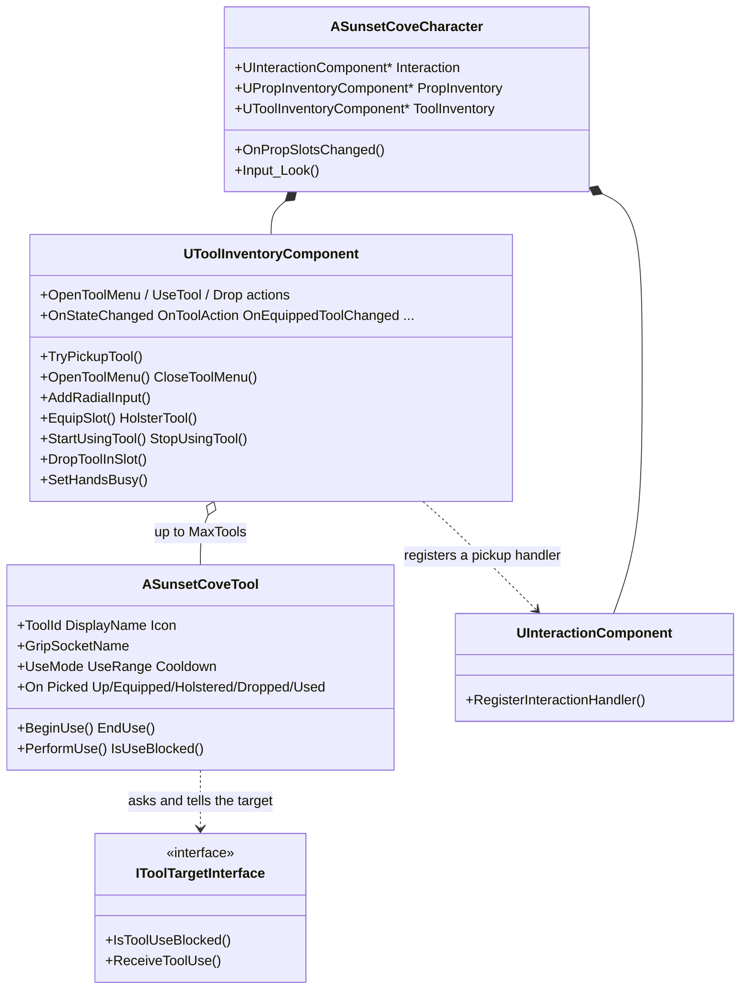
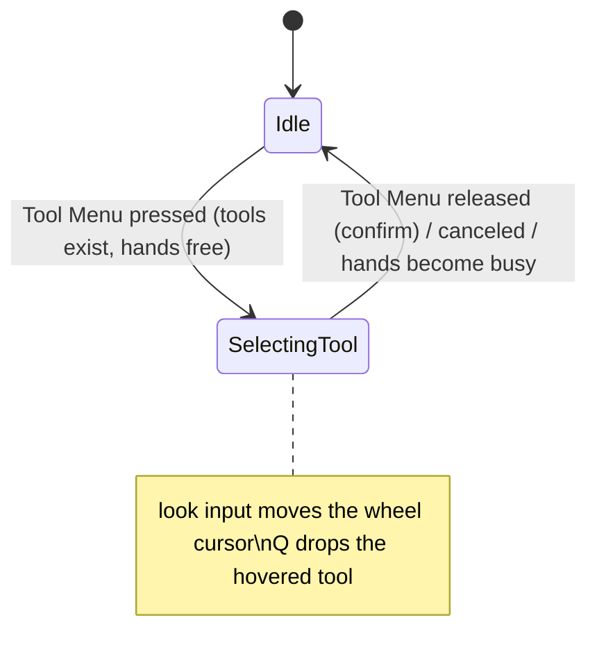

# Architecture Overview — Tool Inventory System

**Project:** Sunset Cove  |  **Engine:** Unreal Engine 5.8  |  **Module:** `SunsetCove`
**Source of truth:** GDD, *Inventario e Strumenti* (Tool Inventory, Strumenti) and *Controlli*.
**Audience:** programmers who build on the system. Whoever sets it up in the editor: see `Engine_Setup_Guide.md`.
**Companion documents:** `../PropInventorySystem/Architecture_Overview.md` (the other inventory), `../../InteractionSystem/Interaction_System.md` (the system that triggers the pickup).

---

## 1. Purpose and boundaries

The Tool Inventory holds the **tools** of the player: the bucket (crabs), the deodorant spray (smelly visitor), the toy (screaming child), the garbage bag (litter) and every tool to come. Per the GDD:

- tools are **found** in the visitors' spots (never bought) and are **used forever** (not consumable);
- the player carries **up to 4** (proposal) and keeps **one** in the hand;
- they are chosen from a **radial menu** opened by holding an action (Tab), and **cannot be selected while props are in the hands**.

It is the sibling of the Prop Inventory (the two hands for sunbeds and umbrellas). They are separate systems and **never include each other**.

| It does | It does NOT do |
|---|---|
| pick a tool up from the world (called by the Interaction System) | spawn tools in the visitors' spots (a future visitor system does that) |
| keep up to `MaxTools` tools, show one in the hand | draw the radial menu (the HUD does it: `UToolRadialMenuWidget`, see `Docs/UISystem/UI_HUD_Architecture.md`) |
| radial selection from the look direction (GTA weapon wheel) | play any animation (only the hooks exist) |
| use the equipped tool (find the target, call it) | decide what a tool *does* to a crab or a child (the target and the tool class do) |
| drop a tool on the ground | load the tools table from the data sheets (`ToolId` is the key for it later) |
| refuse while the hands hold props, and say why | |

The dependency direction is **one way**:

```
ASunsetCoveCharacter ──creates & wires──► UInteractionComponent
                     ──creates & wires──► UPropInventoryComponent
                     ──creates & wires──► UToolInventoryComponent ──registers a handler──► UInteractionComponent
UToolInventoryComponent ──uses──► ASunsetCoveTool (Public/Gameplay/Tools/)
ASunsetCoveTool         ──asks──► IToolTargetInterface (Public/Interfaces/)
IToolTargetInterface / UInteractionComponent / UPropInventoryComponent   never include anything of the Tool Inventory
```

Nothing in `Plugins/CoreFramework` was changed. The framework has no handler for these actions, so the project binds its own Input Actions in `ASunsetCoveCharacter::SetupSunsetCoveInput`, and takes the look input while the menu is open in the character's own `Input_Look` override (the "veto" spot the framework documents).

---

## 2. Files and folder layout

```
Source/SunsetCove/
├── Public/Interfaces/
│   └── ToolTargetInterface.h              IToolTargetInterface  "a tool can be used on this actor" (crab, child, litter...)
├── Public/Gameplay/Tools/SunsetCoveTool.h        ASunsetCoveTool  base class of every tool (Blueprint children), EToolUseMode
├── Private/Gameplay/Tools/SunsetCoveTool.cpp
├── Public/InventorySystem/ToolInventorySystem/
│   ├── ToolInventoryTypes.h               EToolInventoryState, EToolAction, EToolRefusal, FToolSlot, delegate signatures
│   └── ToolInventoryComponent.h           UToolInventoryComponent  slots, pickup, radial menu, equip, use, drop, input
├── Private/InventorySystem/ToolInventorySystem/ToolInventoryComponent.cpp
├── Public/Core/Utils/SunsetCoveHeldItemUtils.h   grip math + box fit, shared by tools and props
├── Public/Core/Utils/SunsetCoveViewUtils.h       camera view point of the player (already used by the other systems)
└── (modified) Public/Character/SunsetCoveCharacter.h + Private/Character/SunsetCoveCharacter.cpp
```

`Content/InventorySystem/ToolInventorySystem/` is where the editor assets go (Input Actions); tool Blueprints go in `Content/Gameplay/Tools/`. Nothing in C++ depends on those paths.

---

## 3. Architecture overview

### 3.1 Classes



### 3.2 Who does what in the character

`ASunsetCoveCharacter` is the composition root and stays thin. For the tools it only:

1. creates the component in the constructor;
2. in `PostInitializeComponents`: gives it the meshes (`SetHandMeshes(FirstPersonMesh, GetMesh())`) and registers the pickup with the Interaction System (`RegisterWithInteraction`);
3. binds `PropInventory->OnSlotsChanged` to `OnPropSlotsChanged`, which calls `ToolInventory->SetHandsBusy(PropInventory->IsHoldingAnyProp())` (the **only** link between the two inventories);
4. in `SetupSunsetCoveInput`: calls `ToolInventory->SetupInput()`;
5. in `Input_Look` (before `Super`): while the radial menu is open, forwards the look value to `ToolInventory->AddRadialInput()` and returns without moving the camera;
6. in `UnPossessed`: calls `ToolInventory->CancelCurrentAction()`.

### 3.3 States

The component has two states. A tool being used is a separate flag (`IsUsingTool()`), because it is independent of the menu.



There is **no tick**: everything is driven by input events.

---

## 4. The classes

### 4.1 `ASunsetCoveTool` — the base class of every tool

The tool counterpart of `ASunsetCoveProp`: **create a Blueprint whose parent is "Sunset Cove Tool", set the skeletal mesh, the `ToolId` and the name, and the tool works.**

| Part | What it is |
|---|---|
| `CollisionBody` (root) | An invisible `UBoxComponent`, Movable, `PhysicsActor` preset. The interaction trace hits it (so the player can aim at the tool) and it is what falls when the tool is dropped. Auto-fitted to the mesh bounds. |
| `ToolMesh` | The skeletal mesh, a child of the box, **no collision**. Tools animate like props, so they are skeletal meshes built in Blender. |
| Identity | `ToolId` (`FName`, the row name in the tools table; two tools with the same id are the same tool), `DisplayName` (`FText`), `Icon` (soft texture) — what the radial menu widget needs. |
| Grip | `GripSocketName` (default `Grip_R`): the bone of the tool's skeleton that lands on the hand socket. `HoldLocationOffset` / `HoldRotationOffset`: a small fine tune on top. |
| Use rules | `UseMode` (`Press` or `Hold`), `UseCooldownSeconds`, `HoldUseInterval`, `UseRange`, `UseTraceRadius`, `UseTraceChannel`, `bRequiresTarget`. |
| Other | `bCanBePickedUp`, `MassKg`, `bStartSimulatingPhysics`, optional `EquipAnimation` / `UseAnimation`. |

**The life of a tool**

| Where | What the tool is |
|---|---|
| In the world | A solid box with the mesh. Static until picked up. |
| Stored | Hidden, collision off, physics off, attached to the hand socket. |
| Equipped | Shown, still attached to the hand socket. |
| Dropped | Detached, shown, collision and physics on, flying out gently, then at rest: a world tool again, which can be picked up again. |

**Using a tool**

```
BeginUse()  (player pressed the use action)
   Press mode:  PrepareUse -> if ok: BP "On Use Started", ExecuteUse           (returns false if nothing can happen)
   Hold mode:   BP "On Use Started", try one use now, then repeat every HoldUseInterval  (returns true)
EndUse()    (player released) -> stop the repeat, BP "On Use Ended"

PrepareUse:  has a holder? IsUseBlocked()? cooldown over? FindUseTarget(); with bRequiresTarget a missing target = no use
ExecuteUse:  start the cooldown, play UseAnimation, PerformUse(Target, Hit), OnUsed delegate, BP "On Used"
PerformUse:  default = IToolTargetInterface::ReceiveToolUse on the target. Override it for a tool with its own effect.
FindUseTarget: a sphere sweep from the player's view (UseRange, UseTraceRadius). The first thing hit is the target if it
               implements IToolTargetInterface and its IsToolUseBlocked is false. The out hit is always filled
               (the end of the range if nothing was hit), so a spray without a target still has a place to aim at.
```

`PerformUse` and `IsUseBlocked` are `BlueprintNativeEvent`s, so a tool Blueprint can override them as well as a C++ subclass.

**The grip.** The animator puts a `Grip_R` bone on the tool and a hand socket on the arms, in Blender. The system attaches the tool by its root (the box) at the transform `RootInHandSocket = GripInRoot⁻¹ · FineTune`, so the grip lands exactly on the hand socket. This math is in `SunsetCoveHeldItemUtils.h` and is the same one props use (`ASunsetCoveProp` was changed to call it; behavior unchanged).

### 4.2 `IToolTargetInterface` — what a tool is used ON

Implemented by the crab, the smelly visitor, the child, the litter, the vandal. Two functions, both optional:

| Function | Meaning | Default |
|---|---|---|
| `IsToolUseBlocked(Tool, User, Hit)` | refuse this use (wrong tool, already solved) | `false` (no objection) |
| `ReceiveToolUse(Tool, User, Hit)` | the tool was used on me: do the effect | does nothing, returns `false` |

Same "blocked check" convention as `IPropInterface`: a Blueprint that adds the interface but implements nothing gets `false`, which means "no objection". The target reads `Tool->ToolId` to know which tool it is.

### 4.3 `UToolInventoryComponent`

**Slots.** `MaxTools` slots (default 4, 1-12), fixed at `BeginPlay`. `StartingTools` (classes) are spawned and picked up one frame after `BeginPlay`, in order (authority only). `FToolSlot` = the tool and the collision mode it had before the pickup. `EquippedSlotIndex` (-1 = holstered).

**The hand socket.** Looked up by name on the first-person arms: `ToolSocketName` (`Tool_R`) first, then `FallbackToolSocketName` (`Prop_R`), then a relative offset from the arms mesh (`FallbackLocation` / `FallbackRotation`) with one warning. So a dedicated tool hand point in Blender is optional. A bone and a socket are equivalent (`DoesSocketExist` resolves both). `BeginPlay` checks the names once and logs what is missing.

**Slot order and radial layout.** Slot *i* sits in sector *i* of the wheel; sector 0 is centered at `RadialStartAngleDegrees` (0 = straight up), the others follow clockwise. There are always `Slots.Num()` equal sectors, a sector with no tool selects nothing.

**Safety.** Destroyed tools are pruned from the slots on every command. `CancelCurrentAction()` closes the menu and ends a use; it runs on unpossess and `EndPlay`. The temporary Pawn-channel ignore after a drop is restored on pickup and on `EndPlay`.

---

## 5. Flows

### 5.1 Pickup (E on a tool)

```
Interaction System: focus on a tool (CanHandleInteraction: it is an ASunsetCoveTool, free-standing, not already owned)
   E pressed -> HandleInteraction -> TryPickupTool(Tool)
     hands busy?            -> refuse HandsBusy
     tool.bCanBePickedUp?   -> refuse ToolBlocked
     same ToolId owned?     -> refuse AlreadyOwned     (unless bAllowDuplicateTools)
     no free slot?          -> refuse InventoryFull
     otherwise: restore a leftover Pawn response, save collision, physics off, collision off,
                attach to the hand socket (grip aligned), hide, Tool->NotifyPickedUp
                OnToolAction(Pickup), OnSlotsChanged
                bAutoEquipFirstTool and nothing equipped -> equip it
```

A refused pickup leaves the tool where it was and fires `OnActionRefused(Reason, Tool)`. The tool stays interactable while refused on purpose: the player presses E and is *told why* (a future message), instead of the tool silently not reacting.

### 5.2 The radial menu (hold Tab) — GTA weapon wheel

```
Tool Menu pressed  -> OpenToolMenu: refused if hands busy (HandsBusy) or no tools (NoTools).
                      Stops a use in progress, resets the wheel, state = SelectingTool.
look input (every frame the player moves the mouse / stick)
   ASunsetCoveCharacter::Input_Look -> ToolInventory->AddRadialInput(LookValue); camera does NOT move
   RadialVector += LookValue / RadialRadius, clamped to length 1      (a cursor on the wheel)
   inside RadialDeadZone  -> nothing selected
   outside                -> angle = atan2(X, Y) clockwise from up; sector = floor((angle - Start + width/2) / width)
                             sector with a tool -> hovered (OnRadialHoverChanged), empty sector -> nothing
Tool Menu released -> CloseToolMenu(confirm):
     a tool hovered, not the equipped one  -> equip it (the previous one is holstered)
     the equipped tool hovered             -> holster it (hands free)
     nothing hovered (a quick tap)         -> holster the equipped tool (hands free)
   (exception: right after a drop from the menu, "nothing hovered" changes nothing)
Canceled / unpossess / hands become busy -> close without changing anything
```

The sector is decided by the **direction of the look movement**, not by a click: no mouse button is involved in selecting. The left mouse button only *uses* the equipped tool when the menu is closed.

### 5.3 Equip and holster

`SetEquippedSlot(Index)` is the one place that changes the equipped tool. It ends a use in progress, holsters the current tool (hide, `NotifyHolstered`, `OnToolAction(Holster)`), shows and equips the new one (`NotifyEquipped` plays `EquipAnimation`, `OnToolAction(Equip)`), and fires `OnEquippedToolChanged(New, Old, Slot)` once.

### 5.4 Use (left mouse)

`Started` -> `StartUsingTool`: needs state `Idle`, hands free, a tool equipped. Calls `Tool->BeginUse()`; if it accepted, `OnToolAction(UseStarted)`. `Completed` / `Canceled` -> `StopUsingTool` -> `Tool->EndUse()`, `OnToolAction(UseEnded)`. The tool does the work (section 4.1).

### 5.5 Drop (Q with the menu open)

```
Drop pressed (the action is shared with the Prop Inventory) and the menu is open with a tool hovered:
   DropToolInSlot(Hovered):
     if it is the equipped tool -> holster it first (events in order: Holster, Drop)
     detach, clear the slot; the wheel goes back to the center, "release does not change the equipment"
     wall trace camera -> tool: if a wall is in the way, drop in front of it (DropWallMargin)
     show, collision back (with physics), ignore the Pawn channel for DropPawnIgnoreSeconds,
     physics on, velocity = heading * DropForwardSpeed + up * DropUpSpeed + owner velocity * InheritOwnerVelocityScale
     Tool->NotifyDropped, OnToolAction(Drop), OnSlotsChanged
```

The velocity is set directly, not as an impulse, so a drop does not depend on the mass of the tool. With the menu closed, Q does nothing for tools (it drops props, if any are held).

### 5.6 Props take the hands

`SetHandsBusy(true)` (from the character, when the Prop Inventory holds a prop): ends a use, closes the menu without confirming, holsters the equipped tool. **It stays holstered** after the props are gone: the player picks it again from the menu. While busy, pickup, menu and use are refused (`HandsBusy`). `SetHandsBusy(false)` does nothing more.

---

## 6. Input

All actions are owned by the component (`UInputAction` properties) and bound in `SetupInput`. Defaults come from the GDD *Controlli*:

| Property | Keyboard / mouse | Controller (proposal) | Events used |
|---|---|---|---|
| `OpenToolMenuAction` | Tab (hold) | R1 / RB (hold) | `Started` opens, `Completed` confirms, `Canceled` cancels |
| `UseToolAction` | Left mouse | R2 / RT | `Started` begins, `Completed` / `Canceled` ends |
| `DropAction` | Q | Y / Triangle | `Started` (acts only with the menu open and a tool hovered) |
| (Interaction System) `InteractAction` | E | A / Cross | pickup |

**Shared actions.** The Prop Inventory's `PlaceAction` and `UseToolAction` are the **same left mouse button**, and both inventories' `DropAction` are the **same Q**. Assign the **same Input Action asset** to both properties: each component acts only in its own situation (props in the hands / a tool equipped; props in the hands / menu open), and one asset per key avoids two actions competing for a key (Enhanced Input "consume input"). The setup guide has the table.

---

## 7. Hooks for the UI and the animation (nothing is drawn or played by the system)

### 7.1 Events (`BlueprintAssignable` on the component)

| Event | When | Use it for |
|---|---|---|
| `OnStateChanged(New, Old)` | menu opened / closed | show and hide the radial menu widget |
| `OnRadialHoverChanged(SlotIndex)` | the sector under the look direction changed (-1 none) | highlight a sector |
| `OnEquippedToolChanged(New, Old, Slot)` | the tool in the hand changed | update the HUD, swap the hand pose |
| `OnToolAction(Action, Slot, Tool)` | Pickup, Equip, Holster, UseStarted, UseEnded, Drop (the logical state has changed; the physical effect may follow, 7.5) | reactions and the Use animation. **To start the animation of Pickup, Equip, Holster or Drop use the `ActionBeginHook` (7.5)**: the arms animation system does |
| `OnSlotsChanged()` | a slot was filled or emptied | rebuild the wheel icons |
| `OnActionRefused(Reason, Tool)` | HandsBusy, InventoryFull, AlreadyOwned, ToolBlocked, NoTools | the message to the player |

`ASunsetCoveTool` has its own events: Blueprint events *On Picked Up / On Equipped / On Holstered / On Dropped / On Use Started / On Use Ended / On Used* and the `OnUsed` delegate (sound, particles, tool-side animation).

### 7.2 Queries (`BlueprintPure`)

`GetState`, `IsRadialMenuOpen`, `AreHandsBusy`, `GetNumSlots`, `GetNumTools`, `GetSlotTool(i)`, `GetEquippedSlotIndex`, `GetEquippedTool`, `IsToolEquipped`, `IsUsingTool`, `GetHoveredSlotIndex`, `GetRadialVector` (X right, Y up, length 0-1: a cursor for the widget), `GetRadialSlotAngle(i)` (clockwise from up, to place icon *i*).

### 7.3 How to build the radial menu widget later

1. Bind **On State Changed**: show the widget on `SelectingTool`, hide on `Idle`.
2. For each slot `0 .. GetNumSlots-1` place an icon at `GetRadialSlotAngle(i)`; get the picture and the name from `GetSlotTool(i)` (`Icon`, `DisplayName`); empty slot = empty sector. Rebuild on **On Slots Changed**.
3. Highlight the sector of **On Radial Hover Changed**. Draw a cursor at `GetRadialVector`.
4. Nothing to do on release: the component equips or holsters by itself. If the widget has its own mouse cursor, call `SetHoveredSlot(i)` instead of using the look input.

### 7.4 Animations

- **Arms:** done by the arms animation system, `../../AnimationSystem/Architecture_Overview.md`. It starts the animation of Pickup, Equip, Holster and Drop from the `ActionBeginHook` (7.5), the Use animation from `OnToolAction(UseStarted / UseEnded)` and the hold pose from `OnEquippedToolChanged`. Nothing to wire.
- **Tool-side animation:** `EquipAnimation` / `UseAnimation` (an asset played once on `ToolMesh`) or, for an Animation Blueprint on `ToolMesh`, the tool's Blueprint events.
- **Hold poses:** the Animation Blueprint of the arms reads `IsToolEquipped`, `GetEquippedTool` and `IsUsingTool`.

### 7.5 Commit timing: logical state now, physical effect when the animation says

The slots and the equipped tool change the **instant the player acts**: a tool is equipped, holstered or dropped whatever an animation does. The **physical effect** can be delayed to a moment of an animation:

| Action | Immediate part (logical) | Delayed part (physical) |
|---|---|---|
| Pickup | slot filled, collision off, `OnToolAction(Pickup)`, `OnSlotsChanged` | attach to the hand socket, hide, `NotifyPickedUp` |
| Equip | `EquippedSlotIndex`, `OnToolAction(Equip)`, `OnEquippedToolChanged` | show the tool, `NotifyEquipped` |
| Holster | `EquippedSlotIndex`, `OnToolAction(Holster)`, `OnEquippedToolChanged` | hide the tool, `NotifyHolstered` |
| Drop | slot emptied, drop speed decided, `OnToolAction(Drop)`, `OnSlotsChanged` | `CommitDrop`: detach, wall-safety trace, show, launch, `NotifyDropped` |

`UToolInventoryComponent::ActionBeginHook` (a C++ delegate) is called after the logical part and before the physical part; its listener starts an animation and returns an `FActionCommitTiming` (`Core/Utils/SunsetCoveActionCommit.h`): **Immediate**, **AfterDelay** or **OnNotify** (then `CommitPendingAction()` releases it, with a timeout as a safety net). **With no hook bound everything is immediate, exactly as before.**

Rules: the tool cannot be used while its Equip is pending. A **swap** (Holster and Equip in one call), the **drop of the equipped tool** and **hands that become busy** hide the old tool at once and call no hook for it; only the new Equip is timed. With **auto-equip**, the first Pickup puts the tool in the hand at once and the Equip is the timed moment. A new action (`TryPickupTool`, `SetEquippedSlot`, `DropToolInSlot`) and `CancelCurrentAction` (also `EndPlay` and the unpossess) apply a pending effect at once; a tool destroyed while pending is skipped. `IsCommitPending()` says whether one is waiting. The timing of *Use* is not part of this (a natural next step with the same mechanism).

**Future work (requested by the project owner):** the tool Pickup should not teleport either: the tool should travel toward the hand and attach when it arrives. The place is the physical pickup lambda in `TryPickupTool` (a `FUTURE:` comment marks it).

---

## 8. Integration with the rest of the project

| System | How |
|---|---|
| **Interaction System** | `ToolInventory.Pickup` handler (`CanHandle`: a free-standing `ASunsetCoveTool`; `Handle`: `TryPickupTool`). The Interaction System does not know what a tool is. |
| **Prop Inventory** | no code link. The character calls `SetHandsBusy` from `OnPropSlotsChanged`. |
| **CoreFramework** | not touched. Input is bound by the project; the look input is taken in the project's own `Input_Look` override. |
| **Adversities** (future) | implement `IToolTargetInterface` on the crab, the child, the smelly visitor, the litter; read `Tool->ToolId`. |
| **Visitors' spots** (future) | spawn a tool Blueprint at the spot (`SpawnActor`). It is a normal world tool: the player aims and presses E. |
| **Rest spots** | tools are not props and have no rest spots. Nothing to do. |

---

## 9. Extending the system

**A new tool** (for example a net): Blueprint child of `Sunset Cove Tool`; set the mesh, `ToolId`, `DisplayName`, `Icon`, `UseMode`, `UseRange`. Add a `Grip_R` bone in Blender. If its effect is only "tell the target", nothing else is needed.

**A tool with its own effect** (the spray particle): override `PerformUse` in a Blueprint, or derive a C++ class from `ASunsetCoveTool` and override `PerformUse_Implementation`. Use `bRequiresTarget = false` for effects that work on empty air.

**A target for tools** (the crab): add the *Tool Target Interface* in Class Settings. In `Is Tool Use Blocked`, return true unless `Tool.ToolId` is the one that works on you; in `Receive Tool Use`, do the effect (collect the crab) and return true.

**A tool that is refused for a game reason:** override `IsUseBlocked` (not now, broken) or set `bCanBePickedUp` to false (locked until a condition).

---

## 10. Assumptions, limits and future work

- **Single player.** Nothing replicates, no RPCs. Everything runs on the local machine.
- **One tool in the hand, one hand socket.** Tools use the right-hand point. A second hand for tools is not supported.
- **Slots are fixed at `BeginPlay`.** `MaxTools` is not meant to change while playing.
- **The look axis may need a flip.** If moving the mouse up selects the bottom sector, turn on `bInvertRadialY`. The sign of the look input depends on the mapping of the framework's look action, which could not be read.
- **The camera does not move while the menu is open.** Only the look input is redirected; movement keys still work (no slow motion and no pause).
- **Equip is instant.** There is no equip delay state. When the equip animation needs to block the use for a while, add an `Equipping` state to the component; `OnToolAction(Equip)` is the place to start it.
- **A tool stored in a character that is destroyed** is left hidden in the world (the same limit as props in hands). Not a concern for a single character that lives for the whole level.
- **Not verified in the editor.** The code was compiled with the UE 5.8 toolchain; the feel (wheel sensitivity, drop force, hand placement) needs a playtest. The checklist is in the setup guide.
- **Future work:** spawn tools at the visitors' spots with `probabilita_spawn` from the data tables (use `ToolId` as the row key); the radial menu widget; arms montages; per-tool rules for hitting vandals (the GDD leaves them undefined); an equip delay state.
